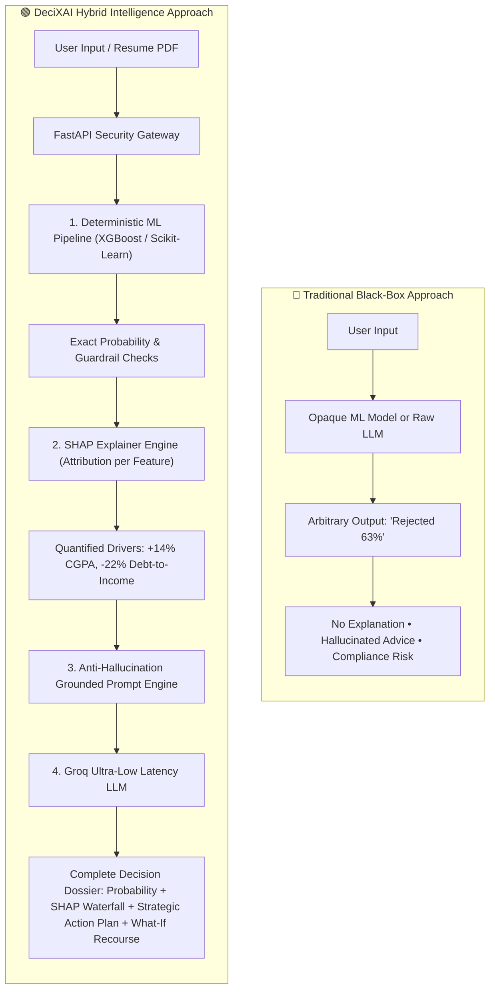
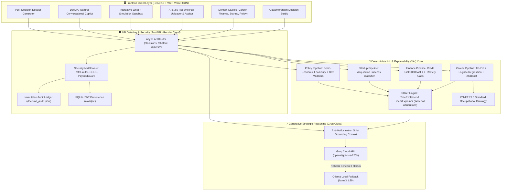
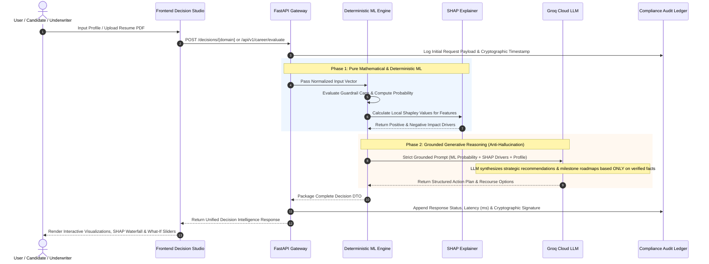
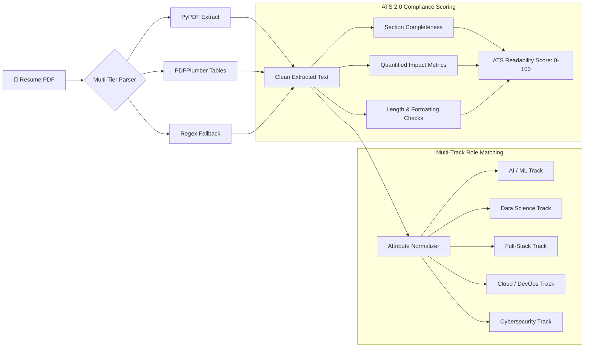
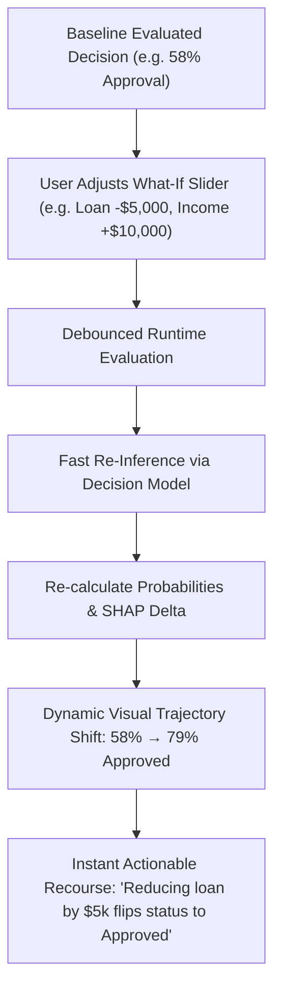
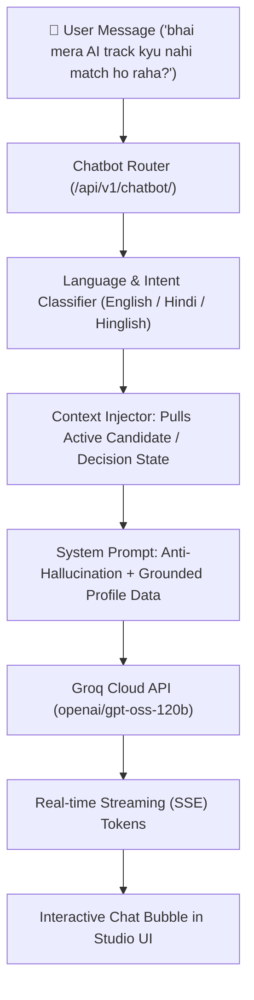
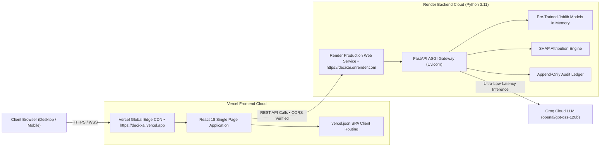

# 🚀 DeciXAI — Enterprise Explainable AI (XAI) Decision Intelligence Platform

<div align="center">

[](https://deci-xai.vercel.app/)
[](https://decixai.onrender.com)
[](https://decixai.onrender.com/docs)


<p align="center">
  <strong>Grounded Multi-Domain Decision Intelligence &bull; Dynamic ATS 2.0 Resume Intelligence &bull; Transparent Explainability (SHAP) &bull; Immutable Regulatory Audit Trail</strong>
</p>

| Service | Live URL | Description |
| :--- | :--- | :--- |
| 🖥️ **Frontend Studio (Vercel)** | [https://deci-xai.vercel.app/](https://deci-xai.vercel.app/) | Interactive Glassmorphism UI (React 18 + Vite) |
| 🛡️ **Backend Engine (Render)** | [https://decixai.onrender.com](https://decixai.onrender.com) | FastAPI Core + ML Models + SHAP Inference |
| 📖 **Interactive API Docs** | [https://decixai.onrender.com/docs](https://decixai.onrender.com/docs) | Swagger UI for Developer Integrations & Testing |

</div>

---

## 📌 Table of Contents
1. [The Problem We Are Solving](#-the-problem-we-are-solving)
2. [The DeciXAI Solution](#-the-decixai-solution)
3. [Problem vs Solution Architecture Comparison](#-problem-vs-solution-architecture-comparison)
4. [High-Level System Architecture](#-high-level-system-architecture)
5. [End-to-End Decision Flow & Anti-Hallucination Pipeline](#-end-to-end-decision-flow--anti-hallucination-pipeline)
6. [Core Decision Studios (Deep-Dive)](#-core-decision-studios-deep-dive)
   - [1. Career & Talent Intelligence (ATS 2.0)](#1--career--talent-intelligence-ats-20)
   - [2. Finance & Credit Risk Intelligence](#2--finance--credit-risk-intelligence)
   - [3. Startup & Venture Viability Studio](#3--startup--venture-viability-studio)
   - [4. Public Policy & Governance Studio](#4--public-policy--governance-studio)
7. [Interactive What-If Simulation & Counterfactual Engine](#-interactive-what-if-simulation--counterfactual-engine)
8. [Conversational AI Copilot Architecture](#-conversational-ai-copilot-architecture)
9. [Regulatory Compliance & Cryptographic Audit Ledger](#-regulatory-compliance--cryptographic-audit-ledger)
10. [Cloud Deployment & Network Topology](#-cloud-deployment--network-topology)
11. [Technology Stack](#-technology-stack)
12. [Project Structure](#-project-structure)
13. [API Reference & OpenAPI Schema](#-api-reference--openapi-schema)
14. [Local Development & Quickstart](#-local-development--quickstart)

---

## 🛑 The Problem We Are Solving

High-stakes decision-making across **hiring**, **credit lending**, **venture capital**, and **public governance** has increasingly been handed over to AI systems. However, organizations and individuals face critical, systemic bottlenecks:

```mermaid
flowchart TD
    subgraph P1["❌ 1. The Black-Box Dilemma"]
        A1["Complex ML / Neural Nets"] --> B1["Binary 'Approved' or 'Rejected'"]
        B1 --> C1["Zero Mathematical Justification ('Computer Says No')"]
    end

    subgraph P2["❌ 2. The LLM Hallucination Trap"]
        A2["Prompting Generative LLMs Directly"] --> B2["Invented Risk Scores & Ghost Numbers"]
        B2 --> C2["Non-deterministic, Unauditable & Dangerous"]
    end

    subgraph P3["❌ 3. Zero Actionability (No Recourse)"]
        A3["User Rejection"] --> B3["No Counterfactual Feedback"]
        B3 --> C3["Candidate doesn't know what exact changes would flip the verdict"]
    end

    subgraph P4["❌ 4. Regulatory & Compliance Peril"]
        A4["EU AI Act, EEOC, FCRA & Fair Lending"] --> B4["Mandatory Algorithmic Recourse Required"]
        B4 --> C4["Traditional pipelines fail legal and compliance audits"]
    end
```



### Key Real-World Failures:
1. **Unexplained Rejection:** A credit applicant or job seeker is rejected by an automated filter without ever knowing which specific factor caused the failure.
2. **Generative Model Hallucinations:** When organizations ask ChatGPT or Claude to grade resumes or creditworthiness, LLMs invent arbitrary numbers, hallucinate citations, and produce contradictory results for identical inputs.
3. **No Algorithmic Recourse:** Traditional models state *what* happened, but never *how to fix it*. Users cannot see how reducing debt by $5,000 or acquiring 2 specific skills would alter the outcome.
4. **Legal & Compliance Vulnerability:** Modern regulatory frameworks (such as the **EU AI Act**, **US Equal Credit Opportunity Act (ECOA)**, and **EEOC Guidelines**) mandate algorithmic transparency and explainability. Black-box models expose enterprises to massive legal liabilities.

---

## 💡 The DeciXAI Solution

**DeciXAI** bridges the gap between predictive accuracy and explainability by implementing a **Hybrid Decision Architecture**:

```
Deterministic Machine Learning  +  Game-Theoretic Explainability (SHAP)  +  Grounded Generative Synthesis (Groq LLM)
```

| Pillar | How DeciXAI Solves It |
| :--- | :--- |
| **1. Never Hallucinate Scores** | Numerical probabilities and rankings are calculated **100% deterministically** by calibrated Scikit-Learn and XGBoost pipelines trained on real-world datasets. The LLM is never permitted to calculate scores. |
| **2. Explain Every Factor (XAI)** | Every prediction is decomposed into quantifiable positive and negative factor contributions using **SHAP (SHapley Additive exPlanations)**, producing exact mathematical attribution for every feature. |
| **3. Grounded Strategic Synthesis** | The cloud LLM (Groq Cloud API) receives strictly verified context and SHAP drivers, generating step-by-step career roadmaps, debt-reduction plans, or startup runway projections without hallucination. |
| **4. Interactive Counterfactuals** | Real-time **What-If simulation sliders** allow users to adjust variables (income, loan amount, funding, CGPA) and immediately witness the mathematical trajectory shift before committing. |
| **5. Cryptographic Audit Trail** | Every single execution, input parameter, latency metric, and model output is cryptographically serialized into an immutable audit ledger (`decision_audit.jsonl`). |

---

## ⚖️ Problem vs Solution Architecture Comparison



---

## 🏛️ High-Level System Architecture

The following diagram illustrates how the frontend Decision Studio communicates with the FastAPI asynchronous gateway, ML inference pipelines, SHAP explainers, Groq cloud reasoning, and the compliance ledger:



---

## 🔬 End-to-End Decision Flow & Anti-Hallucination Pipeline



---

## 🎯 Core Decision Studios (Deep-Dive)

DeciXAI delivers four domain-specific intelligence modules:

### 1. 🎓 Career & Talent Intelligence (ATS 2.0)
* **Problem:** Candidates get rejected by ATS software with generic automated emails and zero actionable feedback.
* **DeciXAI Solution:**
  - **Multi-Tier PDF Resume Parser:** PyPDF &rarr; PDFPlumber &rarr; Heuristic regex fallback for reliable extraction of contact info, education, skills, and work history.
  - **ATS 2.0 Compliance Audit:** Grades section presence, formatting, word count, and quantified impact metrics (e.g. *"reduced latency by 35%"*).
  - **Multi-Track Role Alignment:** Simultaneously benchmarks credentials against 5 core industry tracks:
    1. *AI Systems & Machine Learning Engineer*
    2. *Data Scientist & Analytics Engineer*
    3. *Full-Stack Software Engineer*
    4. *Cloud & DevOps Architect*
    5. *Cybersecurity Engineer*
  - **O*NET 29.0 Ontology Grounding:** Maps extracted skills to standard national occupational standards, pinpointing exact missing skills and portfolio project recommendations.



---

### 2. 💳 Finance & Credit Risk Intelligence
* **Problem:** Loan applicants face arbitrary denial without knowing what financial balance changes would qualify them.
* **DeciXAI Solution:**
  - **Gradient-Boosted Credit Risk Classification:** Evaluates debt-to-income, loan amount, annual income, credit history, and employment stability.
  - **Deterministic Safety Guardrails:** Hard regulatory caps override pure ML output if Loan-to-Income (LTI) exceeds safe boundaries or credit score falls below threshold.
  - **Algorithmic Recourse:** Computes the exact dollar reduction in loan amount or required income boost to transition from *High Risk* to *Approved*.

---

### 3. 🚀 Startup & Venture Viability Studio
* **Problem:** Founders and investors struggle to assess early-stage venture viability objectively before capital commitment.
* **DeciXAI Solution:**
  - **Acquisition & Survival Classifier:** Evaluates team size, funding runway, market sector dynamics, and founder experience.
  - **Cohort Percentile Benchmarking:** Benchmarks venture metrics against historical 25th, 50th, and 75th percentiles of venture-backed startups to uncover hiring bottlenecks and burn-rate warnings.

---

### 4. 🏛️ Public Policy & Governance Studio
* **Problem:** Public socio-economic policies fail during field deployment due to uncalibrated demographic-to-budget ratios and governance friction.
* **DeciXAI Solution:**
  - **Socio-Economic Feasibility Model:** Evaluates proposed scheme budgets against target beneficiary demographic sizes based on historical Indian schemes.
  - **Governance Multipliers:** Adjusts baseline feasibility scores according to political support, infrastructure readiness, administrative urgency, and corruption risk indices.

---

## 🎛️ Interactive What-If Simulation & Counterfactual Engine

DeciXAI features an interactive What-If simulation sandbox that turns static assessments into dynamic sensitivity experiments:



---

## 💬 Conversational AI Copilot Architecture

DeciXAI includes an integrated AI Copilot that allows users to ask questions in both **English** and **Hindi / Hinglish**:



---

## 🔒 Regulatory Compliance & Cryptographic Audit Ledger

Every decision event is recorded in an immutable, append-only JSON Lines ledger (`decision_audit.jsonl`):

```json
{
  "timestamp": "2026-10-26T19:42:01.124Z",
  "request_id": "req_8f192b0c",
  "client_ip": "104.28.194.22",
  "domain": "finance",
  "input_payload": {"income": 85000, "loan": 15000, "credit_score": 740},
  "deterministic_prediction": 0.8842,
  "status": "APPROVED",
  "top_positive_factors": [{"feature": "credit_score", "shap_value": 0.312}],
  "top_negative_factors": [{"feature": "loan_amount", "shap_value": -0.045}],
  "latency_ms": 34.2
}
```

---

## 🌐 Cloud Deployment & Network Topology

DeciXAI is deployed across a multi-cloud production architecture:



---

## 🛠️ Technology Stack

| Layer | Technology | Purpose in DeciXAI |
| :--- | :--- | :--- |
| **Frontend Framework** | **React 18.3.1**, **Vite 5.4.21** | Reactive component architecture, ultra-fast Vite bundler, instant HMR |
| **Styling & Design** | **Tailwind CSS 3.4.3**, **Vanilla CSS** | Glassmorphism design tokens, dark mode palette, smooth micro-animations |
| **Routing** | **React Router DOM 6.18.1** | Declarative SPA client routing with Vercel rewrite persistence |
| **Backend Gateway** | **FastAPI 0.109.0**, **Uvicorn 0.24.0** | High-performance asynchronous REST API, OpenAPI docs, SSE streaming |
| **Machine Learning** | **Scikit-Learn 1.5.2**, **XGBoost 2.1.4** | Calibrated classification, TF-IDF vectorizers, imbalanced learn (SMOTE) |
| **Explainable AI (XAI)**| **SHAP 0.42.0+** | TreeExplainer and LinearExplainer for exact game-theoretic factor attributions |
| **Generative LLM (Cloud)** | **Groq Cloud API (`openai/gpt-oss-120b`)** | Sub-second strategic synthesis and narrative roadmaps |
| **Document Processing** | **PyPDF 4.0.0+**, **PDFPlumber 0.10.0+** | Multi-tier PDF parsing, table extraction, and ATS compliance audit |
| **PDF Dossier Export** | **ReportLab 4.4.5** | High-resolution PDF Decision Dossier generation with embedded audit tables |
| **Database & Auth** | **SQLite**, **aiosqlite**, **PyJWT**, **bcrypt** | Secure asynchronous authentication and saved scenario persistence |

---

## 📂 Project Structure

```
19 Decision XAI/
├── Dockerfile                         # Root Dockerfile for Render Docker deployment
├── render.yaml                        # Render Blueprint specification for 1-click backend deployment
├── backend/
│   ├── datasets/                      # Datasets & O*NET 29.0 taxonomy tables
│   ├── models/                        # Pretrained ML model bundles (*.joblib)
│   ├── middleware/                    # Security, rate-limiting, and audit logging middlewares
│   ├── routers/                       # FastAPI router endpoints (career, finance, startup, policy, chatbot)
│   ├── services/                      # Core business logic (SHAP, ATS parsing, ML inference, LLM synthesis)
│   ├── utils/                         # Database helpers, app loggers, prompt templates
│   ├── main.py                        # FastAPI entrypoint, warm-up logic, CORS & dynamic PORT
│   ├── requirements.txt               # Locked Python dependencies
│   ├── runtime.txt                    # Python runtime pin (3.11.3)
│   └── train_models.py                # Automated ML training and serialization script
├── frontend/
│   ├── vercel.json                    # Vercel SPA rewrite configuration
│   ├── package.json                   # Frontend npm dependencies
│   ├── vite.config.js                 # Vite bundler configuration
│   ├── src/
│   │   ├── components/                # Shared UI widgets (DecisionReport, InsightPanel, AppSidebar, Chatbot)
│   │   ├── domains/                   # Dedicated domain studios (career, finance, startup, policy)
│   │   ├── pages/                     # Application pages (Home, DeveloperHub, AuditTrail, SavedProjects)
│   │   └── api.js                     # Unified API client communicating with backend
│   └── .env.example                   # Frontend environment configuration template
├── .env.example                       # Root environment configuration template
├── docker-compose.yml                 # Local multi-container development environment
└── README.md                          # Comprehensive system architecture & developer guide
```

---

## 📡 API Reference & OpenAPI Schema

Interactive Swagger documentation is available at **[https://decixai.onrender.com/docs](https://decixai.onrender.com/docs)**.

### Core Endpoints:
- `POST /decisions/{domain}`: Primary decision engine for any domain (`career`, `finance`, `startup`, `policy`).
- `POST /api/v1/career/parse-resume`: Multipart upload for ATS 2.0 resume extraction.
- `POST /api/v1/career/evaluate`: Full multi-track benchmarking matrix evaluation.
- `POST /api/v1/chatbot/`: Streaming (SSE) or JSON conversational response with Groq LLM.
- `POST /api/v1/export/pdf`: Compiles and downloads the complete PDF Decision Dossier.
- `GET /api/v1/health`: System health status and model availability confirmation.

---

## 💻 Local Development & Quickstart

### 1. Clone Repository & Setup Environment
```bash
git clone https://github.com/RiyanshiVerma-11/DeciXAI.git
cd DeciXAI
cp .env.example .env
```

### 2. Run Backend
```bash
cd backend
pip install -r requirements.txt
python -m uvicorn main:app --host 0.0.0.0 --port 8002 --reload
```
* Backend runs at: `http://localhost:8002` (Docs: `http://localhost:8002/docs`)

### 3. Run Frontend
In a new terminal window:
```bash
cd frontend
npm install
npm run dev
```
* Frontend Studio runs at: `http://localhost:3003`

---

## 📄 License & Attribution

This project is licensed under the **MIT License**.

Developed with ❤️ by **Riyanshi Verma** &bull; Pioneering transparent, mathematically defensible, and actionable Decision Intelligence.
